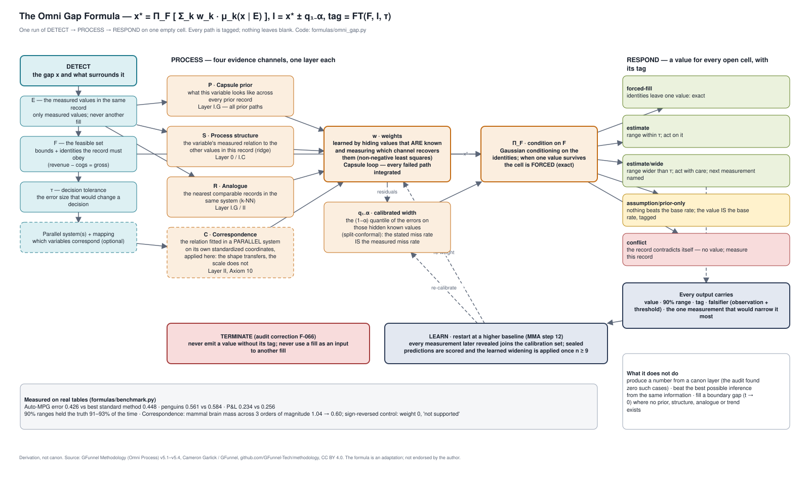
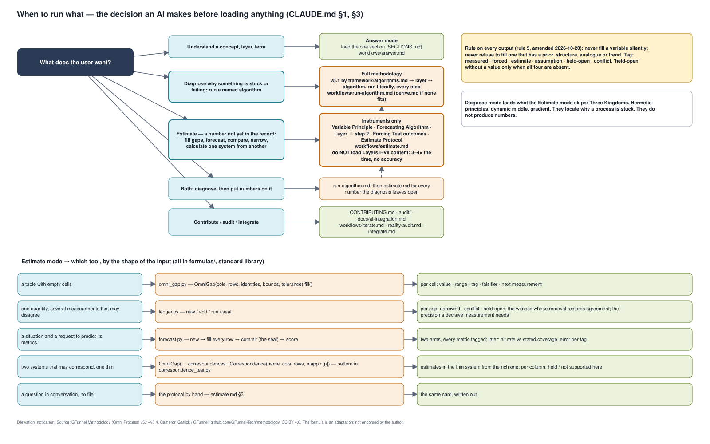
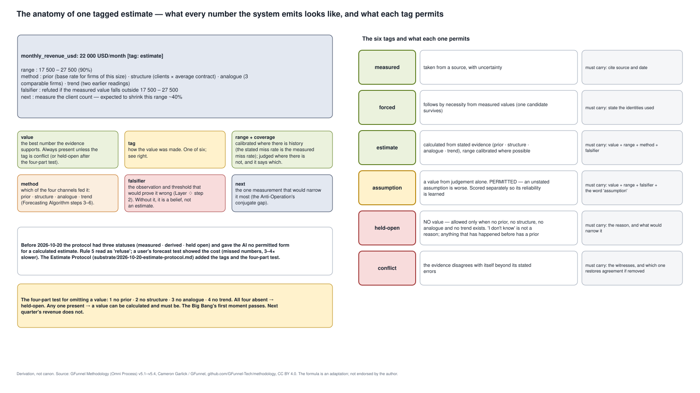
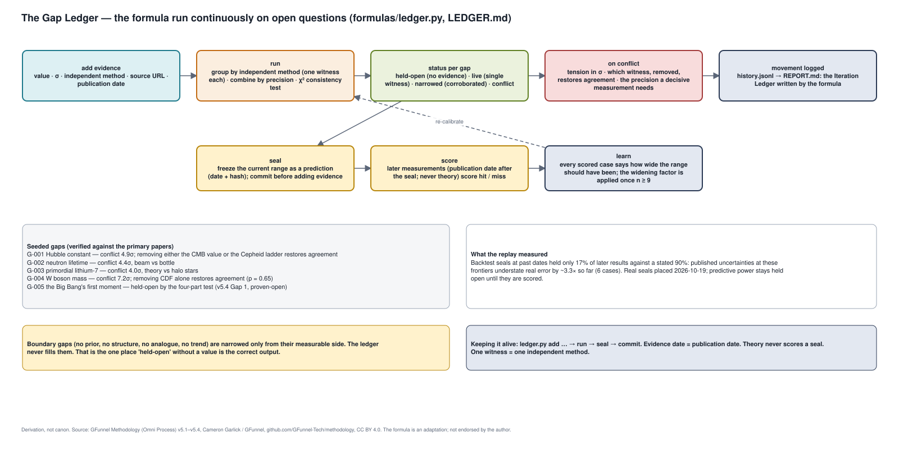

# Diagrams — the Omni Gap Formula, visualised

> Derivation, not canon. Generated by `python3 formulas/diagrams/build_diagram.py` from one layout, so the draw.io file and the SVG previews cannot drift from each other. Regenerate after any change to the formula, the router or the tags; do not edit the outputs by hand.

**Open in draw.io:** [`omni-gap-formula.drawio`](omni-gap-formula.drawio) (four pages; File → Open in [app.diagrams.net](https://app.diagrams.net), or the draw.io desktop app / VS Code extension).

| Page | What it shows | Preview |
| --- | --- | --- |
| 1 · The Formula | One run of DETECT → PROCESS → RESPOND on one empty cell: the four evidence channels (P prior, S structure, R analogue, C correspondence), the learned weights, conditioning on the identities, the five output tags, TERMINATE and the learning loop. Measured results in the footer. | [page-1.svg](page-1.svg) |
| 2 · The Router | The decision an AI makes before loading anything: Answer / Diagnose (full methodology) / Estimate (instruments only) / both / contribute; then, in Estimate mode, which tool for which input shape. This is `CLAUDE.md` §1 and §3 as a picture. | [page-2.svg](page-2.svg) |
| 3 · The Output Card | The anatomy of one tagged estimate (value, tag, range, method, falsifier, next measurement), the six tags with what each must carry, and the four-part test for omitting a value. | [page-3.svg](page-3.svg) |
| 4 · The Living Asset | The Gap Ledger loop: evidence → run → status → conflict analysis → movement logged → seal → score → learned widening; the seeded gaps and what the replay measured. | [page-4.svg](page-4.svg) |









The SVGs are previews rendered by the same script with a minimal text layouter; the `.drawio` file is the editable source of truth for presentation. Content in both comes from the code paths they name: `formulas/omni_gap.py`, `formulas/ledger.py`, `formulas/forecast.py`, `CLAUDE.md`, `substrate/2026-10-20-estimate-protocol.md`.

```
Source: GFunnel Methodology (Omni Process) v5.1–v5.4, Cameron Garlick / GFunnel,
https://github.com/GFunnel-Tech/methodology, CC BY 4.0. Adapted; not endorsed by the author.
```
